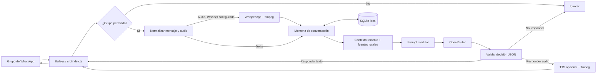

# Arquitectura

## Objetivo y alcance

Este repositorio presenta una implementación modular de un asistente automatizado para grupos de WhatsApp. El flujo separa el transporte de mensajes, el contexto conversacional, las decisiones del modelo, la persistencia local y el procesamiento opcional de audio. No incluye datos de un grupo o negocio concreto.

## Vista general

## Flujo de mensajes

1. **Conexión y alcance.** `src/index.ts` abre la sesión de Baileys, carga los grupos y acepta solo grupos configurados en `ALLOWED_GROUPS` o `SILENT_GROUPS`. Si la lista está vacía, no responde a ningún grupo.
2. **Normalización.** Se descartan mensajes propios y contenido no compatible. Los mensajes de audio pueden transcribirse localmente cuando están instalados Whisper.cpp y ffmpeg.
3. **Ventana de contexto.** `src/agent.ts` toma hasta 12 mensajes recientes dentro de una ventana temporal y limita el texto enviado al modelo. Los documentos Markdown locales bajo `data/context/` se agregan como conocimiento de referencia.
4. **Generación.** `src/prompts.ts` ensambla identidad, reglas de participación, formato y estilo. Los mensajes del grupo y documentos se envuelven como contenido no confiable. `src/openrouter.ts` consulta el modelo configurado y filtra salidas inválidas.
5. **Decisión y envío.** El modelo devuelve `responder`, una razón interna y el texto visible. Si corresponde, `src/index.ts` envía texto o, si se pidió una nota de voz, intenta sintetizarla con los proveedores habilitados.
6. **Persistencia.** `src/db.ts` mantiene historial y notas en SQLite local. Las notas resumen están desactivadas por defecto y se habilitan con `ENABLE_USER_NOTES=true`.

## Componentes

| Módulo | Responsabilidad |
| --- | --- |
| `src/index.ts` | Transporte WhatsApp, permisos por grupo, recepción, límites y envío. |
| `src/agent.ts` | Ventana de mensajes, ensamblado de contexto y decisión de participación. |
| `src/prompts.ts` | Reglas modulares, formato JSON y protección de contenido no confiable. |
| `src/persona.ts` / `src/knowledge.ts` | Identidad configurable y conocimiento base genérico. |
| `src/context.ts` | Carga documentos Markdown locales desde `data/context/`. |
| `src/openrouter.ts` | Cliente LLM, selección de modelos y validación de salida. |
| `src/memory.ts` / `src/db.ts` | Historial y notas guardados localmente en SQLite. |
| `src/transcribe.ts` | Transcripción local opcional y caché de audio. |
| `src/tts.ts` | Síntesis opcional y conversión a OGG/Opus. |
| `src/behavior.ts` | Demoras, cooldown, horario quieto y mensajes espontáneos optativos. |
| `src/config.ts` | Variables de entorno y valores predeterminados. |

## Datos y límites de confianza

- **Sesión:** `auth_info/` contiene credenciales de dispositivo vinculado y nunca debe publicarse.
- **Conversaciones:** `data/bot.db` almacena los mensajes recibidos y enviados para aportar contexto local. El historial no tiene borrado automático en esta plantilla.
- **Notas:** `ENABLE_USER_NOTES` está apagado por defecto. Al activarlo, el resumen solo debe conservar contexto práctico compartido explícitamente; evita datos personales o sensibles.
- **Modelo:** el texto del grupo y el contexto enviado a OpenRouter salen de la máquina local. Informa a los participantes y usa el bot solo con autorización.
- **Audio:** los binarios, pesos de Whisper y cachés se instalan o generan localmente; no están en el repositorio.
- **Configuración:** `.env`, JID de grupos y claves API son locales y están ignorados por Git.

## Decisiones

- **SQLite local:** evita depender de un servicio de base de datos para una instancia pequeña. El archivo se excluye de Git y debe tratarse como información privada.
- **Contexto por archivos:** permite añadir conocimiento específico en Markdown sin modificar el flujo del agente. La carpeta está ignorada para impedir que documentos privados se publiquen accidentalmente.
- **Integraciones opcionales:** transcripción y voz no requieren incluir binarios pesados en el repositorio; se activan cuando se configuran sus dependencias.
- **Lista de grupos explícita:** sin un grupo permitido, el bot no responde.
- **Salida estructurada:** el JSON distingue la decisión de responder de las palabras que se enviarán al grupo.
